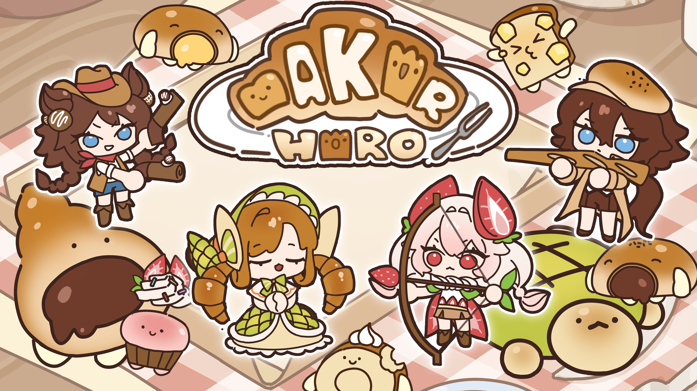
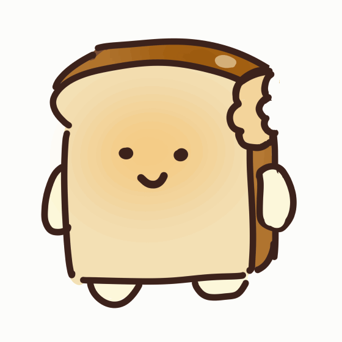
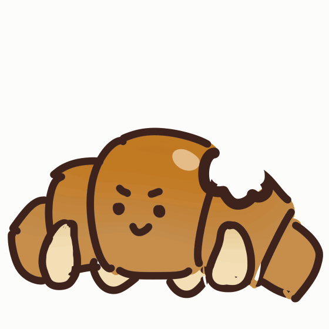

# 🥐 베이커리 히어로 (Bakery Hero)


**갓 구운 평화를 위한 빵빵 터지는 디펜스!**
> 오븐에서 빵 히어로를 뽑고 합성해, 마녀의 빵 군단으로부터 우리 빵집을 지키세요.

**베이커리 히어로**는 꿈사탕팀이 2025 대전 인디(inD) 게임잼의 주제인 ‘빵’을 바탕으로 개발한 2D 랜덤 타워 디펜스 게임입니다. 식빵, 바게트, 크루아상처럼 익숙한 빵을 전투에 배치해 빵집을 지킵니다.

<p>
  
  
  
</p>

| 항목 | 내용 |
| --- | --- |
| 개발팀 | 꿈사탕 |
| 개발 기간 | 2025.07.11–07.13 (게임잼 2박 3일, 제작 약 48시간) |
| 프로젝트 | `KST_GameJam2025` |
| 장르 | 2D 랜덤 타워 디펜스 |
| 플랫폼 | Windows PC |
| 엔진 / 언어 | Unity 2022.3.61f1 / C# |
| 기본 화면 설정 | 1920 × 1080, 16:9 |

## 💾 다운로드

Windows x64용 빌드는 아래 표에서 내려받을 수 있습니다. 
릴리즈 노트와 전체 버전은 GitHub에서 확인하세요. [GitHub Releases](https://github.com/SungJieundev/KkumSaTang/releases)

| 버전 | 받을 파일 | 실행 파일 |
| --- | --- | --- |
| **v0.1.1 · 오류 수정판** | [BakeryHero-v0.1.1-Windows.zip](https://github.com/SungJieundev/KkumSaTang/releases/download/v0.1.1/BakeryHero-v0.1.1-Windows.zip) | `BakeryHero2025.exe` |
| **v0.1.0 · 게임잼 원본** | [BakeryHero-GameJam-Windows.zip](https://github.com/SungJieundev/KkumSaTang/releases/download/v0.1.0/BakeryHero-GameJam-Windows.zip) | `KST_GameJam2025.exe` |

> ZIP의 압축을 모두 푼 뒤, 표에 적힌 실행 파일을 실행하세요.

## 🏆 수상 및 전시

- **2025.07.11–07.13 · 대전 인디(inD) 게임잼 첫인상 부문 수상**. [목원대학교 행사 결과](https://sanhak.mokwon.ac.kr/sub06/data_form.html?md=read&no=140)
- **2025.08.15–08.17 · 부산인디커넥트페스티벌(BIC) 2025 전시**. 부산 벡스코 대전글로벌게임센터 공동관에서 선보였습니다. [대전공동관 전시 보도](https://www.news1.kr/local/daejeon-chungnam/5879888)

## 세계관

골목의 작은 빵집. 경쟁 빵집을 방해하려던 마녀가 금지된 마법을 쓰자 진열대의 빵들이 살아 움직이기 시작합니다. 마녀의 빵 군단이 몰려오고, 갓 깨어난 빵들은 자신들의 빵집을 지키기 위해 전투에 나섭니다.

## 플레이 방식

1. **오븐에서 뽑기** · 코인이나 다이아를 사용해 빵 히어로를 뽑습니다. 소환된 빵은 4×4 격자의 빈칸 한 곳에 무작위로 배치됩니다.
2. **빵 합성하기** · 같은 기본 빵 3개를 합성하면 무작위 상급 빵 1개가 나옵니다. 정해진 빵 2개를 모으면 특수 빵을 만들 수 있습니다. 예를 들어 초코소라빵과 롤빵을 합치면 초코롤빵이 됩니다.
3. **전투와 빈칸 관리하기** · 배치된 빵은 사거리 안에 들어온 적을 자동으로 공격합니다. 칸이 가득 차면 빵을 선택해 제거하고 다음 소환을 위한 자리를 확보할 수 있습니다.
4. **웨이브 버티기** · 적은 전장 외곽을 순환합니다. 10개 웨이브를 버티면 승리하고, 전장에 남아 있는 적이 100마리에 도달하면 패배합니다.

### 주요 시스템

- **전투 보상** · 적을 처치하면 코인을, 웨이브를 넘기면 다이아를 얻습니다.
- **유닛 능력치** · 빵마다 공격력, 공격 간격, 사거리가 다릅니다. 딸기케이크처럼 아군 빵의 공격 능력치를 높이는 특수 빵도 있습니다.

### 조작

| 입력 | 동작 |
| --- | --- |
| 마우스 왼쪽 클릭 | 오븐 뽑기, 합성, 배치된 빵의 능력치 확인 및 제거 메뉴 선택 |
| 아무 키 | 타이틀과 인트로 진행 |

## 실행 방법

### Unity 에디터에서 실행

1. 저장소를 복제합니다.

   ```bash
   git clone https://github.com/SungJieundev/KkumSaTang.git
   ```

2. Unity Hub에서 Unity **2022.3.61f1**을 설치하고, 복제한 저장소 안의 `KST_GameJam2025` 폴더를 프로젝트로 추가합니다.
3. 패키지 복원과 에셋 임포트가 끝나면 `Assets/00.Scenes/TitleScene.unity`를 열고 Play를 누릅니다.

게임은 `TitleScene → Intro → GameScene` 순서로 진행됩니다.

### 빌드

Unity에서 `File > Build Settings`를 열고 Windows를 대상으로 선택합니다. `Scenes In Build`에서 `TitleScene`, `Intro`, `GameScene`이 순서대로 활성화되어 있는지 확인합니다. `Build`를 눌러 출력 폴더를 선택합니다.

## 기술 구성

| 구성 | 용도 |
| --- | --- |
| Unity / C# | 씬 구성, 2D 전투, 웨이브 및 유닛 로직 |
| URP 14.0.12 / Shader Graph | 2D 렌더링과 스프라이트 외곽선 |
| TextMeshPro 3.0.7 / Unity UI | 재화, 웨이브 타이머, 적 수 게이지, 뽑기 및 합성 UI |
| DOTween | 뽑기 결과와 빈 슬롯 안내 팝업 애니메이션 |

### 코드 구조

| 영역 | 주요 구성과 역할 |
| --- | --- |
| 게임 진행 | `GameManager`가 웨이브와 타이머를 관리하고, `MonsterManager`가 적 수와 패배 조건을 처리합니다. |
| 소환 및 재화 | `RandomGacha`가 빵을 뽑아 빈칸에 배치하고, `MoneyManager`가 코인과 다이아를 관리합니다. |
| 합성 및 선택 | `HeroManager`가 합성 조건을 검사하고, `ObjectClick`이 빵 선택과 제거를 처리합니다. |
| 전투 | `MonsterSpawner`가 적의 생성과 이동을, `TowerAttack`이 빵의 자동 공격을 처리합니다. |
| 오브젝트 및 오디오 | `PoolManager`가 유닛을 재사용하고, `AudioManager`가 BGM과 효과음을 재생합니다. |

```text
KST_GameJam2025/
├── Assets/
│   ├── 00.Scenes/      # 전투, 타이틀, 테스트 씬
│   ├── 01.Scripts/     # 게임 진행, 소환, 합성, 전투 로직
│   ├── 02.Sprites/     # 빵 히어로, 몬스터, UI 이미지
│   ├── 03.Prefabs/     # 전투 및 UI 프리팹
│   ├── 04.Animation/   # 캐릭터 애니메이션
│   ├── 05.Audio/       # BGM과 효과음
│   └── Resources/     # 소환에 사용하는 빵 히어로 프리팹
├── Packages/
└── ProjectSettings/
```
